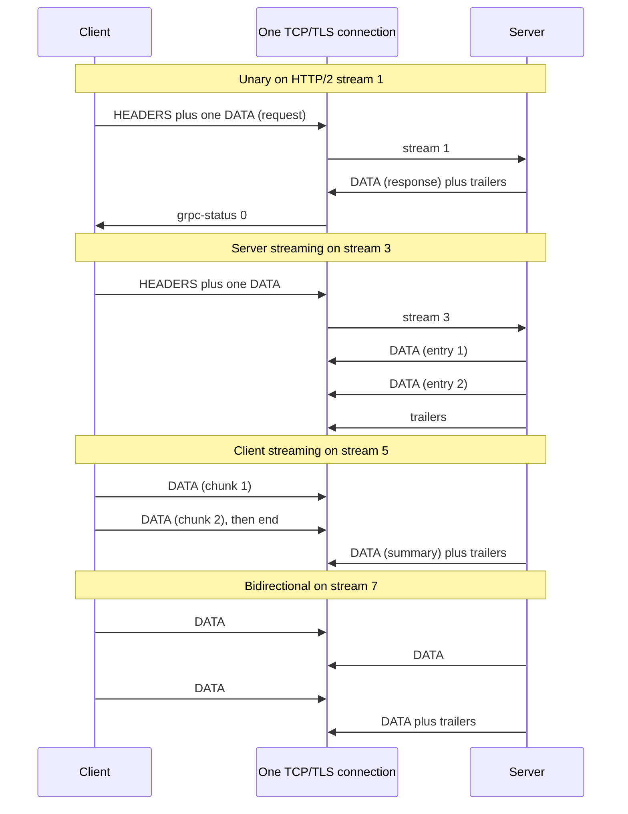

![[39a320b026181de97d0a95c4ec6899d8.jpg]]

gRPC is Google's RPC framework. You describe services and messages in a `.proto` file, Protocol Buffers serialize the payloads, and a generator writes a client and a server in the language you actually ship. In Rust, that runtime is almost always [`tonic`](https://github.com/grpc/grpc-rust). It sits on `tokio`, speaks HTTP/2 through `hyper` and `h2`, and uses `prost` for the protobuf types.

This post started as a short tonic 0.9 sketch: a `Greeter` service, a `build.rs`, and a unary client. That shape is still right. The crate layout is not. In 0.14, codegen moved to `tonic-prost-build`, the prost codec is a separate `tonic-prost` crate, and a few server APIs shifted. What follows is that original path, rewritten against 0.14, plus the wire format, the four RPC shapes, and the security knobs that matter once the listener is on a network you do not fully trust.

## What is actually on the wire

gRPC does not invent a new transport. It is HTTP/2 with a strict usage contract.

One TCP connection, usually wrapped in TLS, carries many concurrent HTTP/2 streams. Each RPC typically gets its own stream. Unary, server streaming, client streaming, and bidirectional streaming all share that one connection. The difference is only how many DATA frames each side writes on its stream, and when it closes.

The HTTP request line you know from REST is gone. A call is a POST (always) to a path built from the proto package:

```text
POST /logs.Log/GetEntry
content-type: application/grpc
te: trailers
grpc-timeout: 2S
authorization: Bearer ...
```

`te: trailers` is required. gRPC puts the real status in trailing headers, after the response body, so the client has to be ready for trailers. HTTP/2 makes that natural. HTTP/1.1 does not, which is why "real" gRPC is HTTP/2 only. Browser clients still need grpc-web or a proxy.

### HPACK

HTTP/2 compresses headers with HPACK. A static table covers the common keys (`:method`, `:path`, `content-type`, and so on). A per-connection dynamic table remembers values already sent. After the first call on a connection, you are not re-sending the same authority and content-type as raw strings every time.

That is a real win when you fire lots of small RPCs. It also means the first request on a fresh connection is the expensive one, and that header state is per connection. If you create a new `Channel` for every call, you throw that away and pay a new TCP and TLS handshake too.

### The 5-byte length-prefixed gRPC message

Inside each HTTP/2 DATA frame, gRPC messages are not raw protobuf bytes. They are length-prefixed frames:

```text
  byte 0              bytes 1-4                 bytes 5 .. 5+N-1
+--------------------+-------------------------+---------------------------+
| compressed-flag    | message length          | protobuf payload          |
| 1 byte             | 4-byte unsigned,        | N bytes                   |
|                    | big-endian              |                           |
+--------------------+-------------------------+---------------------------+

  compressed-flag:
    0x00  payload is raw protobuf
    0x01  payload is compressed with the algorithm named
          in the grpc-encoding header (gzip, deflate, etc.)
```

A single HTTP/2 DATA frame can hold more than one of these, and a large protobuf can span more than one DATA frame. The 4-byte length is what lets the parser find message boundaries. It is also why a hostile length field can hurt you: if you trust `N` and allocate first, a client can ask you to reserve 4 GiB of RAM. `tonic` has a default max of 4 MiB. Set it yourself. More on that later.

### Trailing headers are the real status

The HTTP status on a normal gRPC response is almost always `200`. A failed RPC still often looks like HTTP 200. The code you care about is in the trailing HEADERS frame:

- `grpc-status`: an integer. `0` is OK. `3` is `INVALID_ARGUMENT`, `5` is `NOT_FOUND`, `8` is `RESOURCE_EXHAUSTED`, `13` is `INTERNAL`, `14` is `UNAVAILABLE`, `16` is `UNAUTHENTICATED`, and so on.
- `grpc-message`: optional, percent-encoded text.
- `grpc-status-details-bin`: optional, a serialized `google.rpc.Status` with richer details.

If a proxy, a log, or Wireshark only shows you `:status: 200`, you have not looked at the RPC yet. Jump to the trailers.

> [!warning] Do not map gRPC errors to "the HTTP request failed"
> `tonic` surfaces this as `Status` on the `Err` side of `Result`. Check `status.code()`, not the HTTP status. A timeout is `Code::DeadlineExceeded`. A missing row is `Code::NotFound`. Both can arrive on an HTTP 200 stream.

## The four RPC patterns

All four are declared in the `.proto` file by placing `stream` on the request, the response, neither, or both:

| Pattern | Signature | What happens on the stream |
| --- | --- | --- |
| Unary | `rpc Get(Req) returns (Res)` | Client sends one message. Server sends one message, then trailers. |
| Server streaming | `rpc Follow(Req) returns (stream Res)` | Client sends one message. Server writes many messages, then trailers. |
| Client streaming | `rpc Ingest(stream Req) returns (Res)` | Client writes many messages, then half-closes. Server replies once. |
| Bidirectional | `rpc Tail(stream Req) returns (stream Res)` | Both sides write when they want, on the same HTTP/2 stream, until one ends it. |

They all share a single TCP/TLS connection. HTTP/2 stream IDs opened by the client are odd (1, 3, 5, 7, ...). The diagram below is four RPCs in flight on that one connection, not four sockets.



A deadline on a streaming call covers the whole RPC, not each message. If you set a 2 second timeout on `Follow` and the server is supposed to tail a log for a minute, you will get `DeadlineExceeded` when the clock runs out, even if messages were flowing fine. Pick a timeout that matches the shape of the call, or leave the stream open and cancel it from the client when you are done.

## The Rust stack: tonic, prost, tokio, tower

The moving parts, from the `.proto` file down to the socket:

```text
.proto
  -> tonic-prost-build  (build.rs, shells out to protoc)
  -> generated Rust types, an async server trait, a client stub
  -> tonic              (Status, interceptors, HTTP/2 framing)
  -> tower              (middleware layers around the service)
  -> hyper / h2
  -> tokio              (runtime, timers, I/O)
```

`tonic-build` still exists, but it is the generic codegen engine. For protobuf, you depend on `tonic-prost-build` at build time and `tonic-prost` plus `prost` at runtime. The generated code derives `prost::Message` and uses `tonic_prost::ProstCodec`. If either runtime crate is missing, the project will not compile and the error will look like a missing trait, not a missing generator.

You also need the `protoc` binary on `PATH`, or `PROTOC` pointed at it. `tonic-prost-build` fails fast with "Could not find `protoc`" if it is missing. On Debian or Ubuntu that is `apt install protobuf-compiler`. tonic 0.14 wants Rust 1.88 or newer.

### Project layout

```text
log-service/
  Cargo.toml
  build.rs
  proto/log.proto
  src/server.rs
  src/client.rs
```

### `Cargo.toml`

```toml
[package]
name = "log-service"
version = "0.1.0"
edition = "2024"

[[bin]]
name = "log-server"
path = "src/server.rs"

[[bin]]
name = "log-client"
path = "src/client.rs"

[dependencies]
prost = "0.14"
tokio = { version = "1", features = ["macros", "rt-multi-thread"] }
tokio-stream = "0.1"
tonic = "0.14"
tonic-prost = "0.14"

[build-dependencies]
tonic-prost-build = "0.14"
```

Pin to 0.14.3 or newer if you accept compressed payloads from untrusted peers. 0.14.3 is the release that started applying `max_decoding_message_size` during decompression, not only to the compressed bytes. A gzip bomb that expands past your limit should now be rejected instead of being fully inflated first. 0.14.9 is current as of late October 2026.

### `proto/log.proto`

The original notes used a `Greeter` / `SayHello` unary service. That is enough to learn the loop. The same loop scales to a slightly more realistic log service, with all four RPC shapes in one file. The worked example implements unary `GetEntry` and server-streaming `Follow`. `Ingest` and `Tail` are declared so you can see the `stream` keyword on both sides; the server trait will include them and you can stub them with `Status::unimplemented` until you need them.

```proto
syntax = "proto3";

package logs;

service Log {
  rpc GetEntry (GetEntryRequest) returns (LogEntry);
  rpc Follow (FollowRequest) returns (stream LogEntry);
  rpc Ingest (stream LogEntry) returns (IngestSummary);
  rpc Tail (stream FollowRequest) returns (stream LogEntry);
}

message GetEntryRequest {
  string id = 1;
}

message FollowRequest {
  string source = 1;
  uint32 max_entries = 2;
}

message LogEntry {
  string id = 1;
  string source = 2;
  string body = 3;
  int64 unix_ts = 4;
}

message IngestSummary {
  uint32 accepted = 1;
}
```

### `build.rs`

This file lives next to `Cargo.toml`, not under `src/`. Cargo runs it on every build. The generated Rust goes into `OUT_DIR`.

```rust
fn main() -> Result<(), Box<dyn std::error::Error>> {
    tonic_prost_build::configure()
        .build_server(true)
        .build_client(true)
        .compile_protos(&["proto/log.proto"], &["proto"])?;
    Ok(())
}
```

`tonic::include_proto!("logs")` later pulls that file in. The string is the proto `package` name, not the file name.

### Async server: unary plus server streaming

```rust
use std::time::{SystemTime, UNIX_EPOCH};
use tokio::sync::mpsc;
use tokio_stream::wrappers::ReceiverStream;
use tonic::{Request, Response, Status, transport::Server};

use logs::log_server::{Log, LogServer};
use logs::{FollowRequest, GetEntryRequest, IngestSummary, LogEntry};

pub mod logs {
    tonic::include_proto!("logs");
}

#[derive(Default)]
struct LogService;

fn now_ts() -> i64 {
    SystemTime::now()
        .duration_since(UNIX_EPOCH)
        .map(|d| d.as_secs() as i64)
        .unwrap_or(0)
}

#[tonic::async_trait]
impl Log for LogService {
    async fn get_entry(
        &self,
        request: Request<GetEntryRequest>,
    ) -> Result<Response<LogEntry>, Status> {
        let id = request.into_inner().id;
        if id.is_empty() {
            return Err(Status::invalid_argument("id is required"));
        }
        if id == "missing" {
            return Err(Status::not_found(format!("no entry {id}")));
        }

        Ok(Response::new(LogEntry {
            id,
            source: "api".into(),
            body: "hello from tonic 0.14".into(),
            unix_ts: now_ts(),
        }))
    }

    type FollowStream = ReceiverStream<Result<LogEntry, Status>>;

    async fn follow(
        &self,
        request: Request<FollowRequest>,
    ) -> Result<Response<Self::FollowStream>, Status> {
        let FollowRequest { source, max_entries } = request.into_inner();
        if source.is_empty() {
            return Err(Status::invalid_argument("source is required"));
        }

        let n = max_entries.clamp(1, 32);
        let (tx, rx) = mpsc::channel(8);

        tokio::spawn(async move {
            for i in 0..n {
                let entry = LogEntry {
                    id: format!("{source}-{i}"),
                    source: source.clone(),
                    body: format!("event {i}"),
                    unix_ts: now_ts(),
                };
                if tx.send(Ok(entry)).await.is_err() {
                    // client hung up; stop producing
                    break;
                }
            }
        });

        Ok(Response::new(ReceiverStream::new(rx)))
    }

    async fn ingest(
        &self,
        _request: Request<tonic::Streaming<LogEntry>>,
    ) -> Result<Response<IngestSummary>, Status> {
        Err(Status::unimplemented("Ingest is not wired up in this example"))
    }

    type TailStream = ReceiverStream<Result<LogEntry, Status>>;

    async fn tail(
        &self,
        _request: Request<tonic::Streaming<FollowRequest>>,
    ) -> Result<Response<Self::TailStream>, Status> {
        Err(Status::unimplemented("Tail is not wired up in this example"))
    }
}

#[tokio::main]
async fn main() -> Result<(), Box<dyn std::error::Error>> {
    let addr = "127.0.0.1:50051".parse()?;
    let svc = LogServer::new(LogService::default())
        .max_decoding_message_size(1024 * 1024)
        .max_encoding_message_size(1024 * 1024);

    println!("log-server listening on {addr}");
    Server::builder().add_service(svc).serve(addr).await?;
    Ok(())
}
```

The interesting bits:

- `get_entry` returns a typed `Status` for bad input and missing rows. Those become `grpc-status` trailers, not HTTP 400 / 404.
- `FollowStream` is an associated type on the generated trait. `ReceiverStream` from `tokio-stream` is a common way to turn an `mpsc` queue into that stream. You can also return a `Pin<Box<dyn Stream<Item = Result<LogEntry, Status>> + Send + 'static>>`.
- If `tx.send` fails, the client dropped the stream. Stop writing. Do not keep filling a channel nobody is reading.
- Message size limits are set on the generated `LogServer`, not on `Server::builder()`. 1 MiB is a tighter cap than the 4 MiB default, which is what you want on an untrusted listener.

### Client: deadlines and status handling

```rust
use std::time::Duration;
use tokio_stream::StreamExt;
use tonic::{Code, Request};

use logs::log_client::LogClient;
use logs::{FollowRequest, GetEntryRequest};

pub mod logs {
    tonic::include_proto!("logs");
}

#[tokio::main]
async fn main() -> Result<(), Box<dyn std::error::Error>> {
    let mut client = LogClient::connect("http://127.0.0.1:50051")
        .await?
        .max_decoding_message_size(1024 * 1024);

    let mut get = Request::new(GetEntryRequest { id: "42".into() });
    get.set_timeout(Duration::from_secs(2));

    match client.get_entry(get).await {
        Ok(resp) => {
            let entry = resp.into_inner();
            println!("{} {}: {}", entry.id, entry.source, entry.body);
        }
        Err(status) => match status.code() {
            Code::NotFound => eprintln!("no such entry: {}", status.message()),
            Code::DeadlineExceeded => eprintln!("GetEntry timed out"),
            Code::Unauthenticated => eprintln!("bad or missing token"),
            Code::Unavailable => eprintln!("server is down or not listening"),
            other => eprintln!("GetEntry failed: {other} {}", status.message()),
        },
    }

    let mut follow = Request::new(FollowRequest {
        source: "api".into(),
        max_entries: 5,
    });
    // covers the entire stream, not each message
    follow.set_timeout(Duration::from_secs(10));

    let mut stream = client.follow(follow).await?.into_inner();
    while let Some(next) = stream.next().await {
        match next {
            Ok(entry) => println!("follow {} {}", entry.id, entry.body),
            Err(status) if status.code() == Code::DeadlineExceeded => {
                eprintln!("Follow hit its deadline");
                break;
            }
            Err(status) => {
                eprintln!("Follow broke: {} {}", status.code(), status.message());
                break;
            }
        }
    }

    Ok(())
}
```

`Request::set_timeout` writes the `grpc-timeout` header. The server can see it, and tonic will cancel the call on the client if the timer fires first. You can also set a default on the `Channel` with `.timeout(...)`, then override it per request when a stream needs longer.

### Run it

```bash
# terminal 1
cargo run --bin log-server

# terminal 2
cargo run --bin log-client
```

If `build.rs` cannot find `protoc`, fix that before you go hunting for Rust errors. The generated code will not exist yet.

## Middleware and security

Once a gRPC port is reachable, treat it like any other remote attack surface. The `.proto` file is a map of every method you exposed. Auth, TLS, message limits, and HTTP/2 settings are not extras you add later. They are part of making the server safe to start.

### Tower layers and tonic interceptors

Every tonic service is a `tower::Service`. There are two places to hook in:

- **`Server::builder().layer(...)`** applies to every service on that server. Timeouts, load shedding, tracing, and metrics belong here.
- **Interceptors** (`LogServer::with_interceptor`, or `InterceptedService`) run per request and can inspect or reject metadata before the method body runs. Auth belongs here.

A token check on the interceptor is the minimum:

```rust
use tonic::{Request, Status};

fn auth(req: Request<()>) -> Result<Request<()>, Status> {
    match req.metadata().get("authorization") {
        Some(value) if value.as_bytes().starts_with(b"Bearer ") => Ok(req),
        _ => Err(Status::unauthenticated("missing or invalid token")),
    }
}
```

For a real JWT, do the full verify in that function (or in a small helper it calls): issuer, audience, expiry, and the signature. Do not parse a token in every method by hand. Do not treat "the header is present" as proof that the token is valid.

If you want both an interceptor and a message size cap, set the cap first, then wrap. `with_interceptor` takes the inner service impl, not an already-configured `LogServer`, so this is the pattern that works:

```rust
use tonic::codegen::InterceptedService;

let svc = InterceptedService::new(
    LogServer::new(LogService::default())
        .max_decoding_message_size(1024 * 1024)
        .max_encoding_message_size(1024 * 1024),
    auth,
);

Server::builder()
    .timeout(std::time::Duration::from_secs(30))
    .add_service(svc)
    .serve(addr)
    .await?;
```

The client side is the same idea, inverted: `LogClient::with_interceptor(channel, ...)` can attach the `authorization` metadata on every call, and you can still chain `.max_decoding_message_size(...)` on the client.

### mTLS

Plaintext `http://127.0.0.1` is fine on a laptop. On a real network, use TLS, and if both ends are services you control, use mutual TLS so the server also verifies the client cert.

Enable a rustls backend on `tonic`. In 0.14 the feature is `tls-ring` (or `tls-aws-lc` if you want that provider):

```toml
tonic = { version = "0.14", features = ["tls-ring"] }
```

Server, requiring a client cert signed by your CA:

```rust
use tonic::transport::{Certificate, Identity, Server, ServerTlsConfig};

let cert = std::fs::read("server.pem")?;
let key = std::fs::read("server.key")?;
let client_ca = std::fs::read("client-ca.pem")?;

let tls = ServerTlsConfig::new()
    .identity(Identity::from_pem(cert, key))
    .client_ca_root(Certificate::from_pem(client_ca))
    .client_auth_optional(false)
    .timeout(std::time::Duration::from_secs(10));

Server::builder()
    .tls_config(tls)?
    .add_service(svc)
    .serve(addr)
    .await?;
```

Client, presenting its own cert and trusting that same CA:

```rust
use tonic::transport::{Certificate, Channel, ClientTlsConfig, Identity};

let tls = ClientTlsConfig::new()
    .domain_name("log.internal")
    .ca_certificate(Certificate::from_pem(ca))
    .identity(Identity::from_pem(client_cert, client_key));

let channel = Channel::from_static("https://log.internal:50051")
    .tls_config(tls)?
    .connect()
    .await?;
```

`client_auth_optional(false)` is the default once a CA is set, but set it anyway so the next reader does not have to look it up. The `domain_name` must match the server cert. If you need to decrypt a capture later, call `.use_key_log()` on the TLS config and set `SSLKEYLOGFILE`. The environment variable alone does nothing in tonic; key logging is opt-in per config.

mTLS proves the machine. It does not replace an authorization check for the user or the tenant. Keep the interceptor.

### Cap message size or someone else will cap your memory

The default 4 MiB decode limit is a start, not a policy. Set `max_decoding_message_size` to whatever a legitimate message in this service actually needs, and no more. A "send me a blob" method with a 100 MiB cap is a memory exhaustion primitive, especially if you also allow many concurrent streams.

If you enable request compression, remember the 0.14.3 decompression fix above and still cap the *decoded* size. A 20 KiB gzip body can expand a long way.

### Turn reflection off in production

[`tonic-reflection`](https://docs.rs/tonic-reflection) is handy in development. `grpcurl` can list services and call methods without a proto file. That is also a free map of your attack surface: every package, service, and method name, handed to anyone who can reach the port.

Do not register the reflection service on a production listener. If you want it for internal debugging, bind it to a separate local port, or hide it behind the same auth you already require, and still think twice.

### HTTP/2 flow control and Rapid Reset

HTTP/2 flow control uses window sizes at the connection and at each stream. A very large initial window lets a fast sender fill memory before your application reads. A very small one stalls a legitimate stream. Set them on purpose:

```rust
Server::builder()
    .http2_max_concurrent_streams(Some(256))
    .http2_initial_connection_window_size(Some(1024 * 1024))
    .http2_initial_stream_window_size(Some(64 * 1024))
    .http2_max_pending_accept_reset_streams(Some(32))
    .http2_max_local_error_reset_streams(Some(1024))
    .add_service(svc)
    .serve(addr)
    .await?;
```

Rapid Reset (CVE-2023-44487) is the HTTP/2 trick where a client opens a stream and immediately RST_STREAMs it. Opening and resetting is cheap for the attacker and expensive for a server that already did the work to accept the stream. The pending-reset cap is the direct mitigation in the h2 stack. The concurrent-stream cap bounds how much work can be in flight at once.

Do not put a raw, unauthenticated gRPC port on the public internet if you can avoid it. A mesh or a proxy that already patched this class of HTTP/2 abuse is a better front door than your process alone. Keep tonic itself current; 0.14.9 also exposed reset-stream settings on the client `Endpoint`.

> [!tip] Keepalive is not optional on long-lived connections
> Idle load balancers will silently drop a connection that has had no bytes for a few minutes. Then the next RPC fails with something that looks like `Unavailable`. Set HTTP/2 PING keepalive on both the server and the client (`http2_keepalive_interval`, `http2_keepalive_timeout`) so dead connections are noticed before a user-facing call hits them.

## REST/JSON vs gRPC

|  | REST/JSON over HTTP | gRPC over HTTP/2 |
| --- | --- | --- |
| Contract | OpenAPI, or whatever is in someone's head | The `.proto` file is the contract; both sides generate from it |
| Payload | Text JSON, usually | Binary protobuf (JSON transcoding exists, but it is an add-on) |
| RPC shapes | Unary is natural. Streaming means SSE, chunked HTTP, or a WebSocket | Unary, server, client, and bidirectional are first-class |
| Browser | Works with `fetch` | Needs grpc-web or a proxy. Raw gRPC is not a browser protocol |
| Errors | HTTP status plus a body, invented per API | `grpc-status` in trailers, same codes everywhere |
| Debugging | `curl`, a browser, `jq` | `grpcurl`, Wireshark, or reflection in dev |
| Versioning | New routes or headers | New fields are cheap if you never reuse field numbers |
| On-the-wire size | Larger, human-readable | Smaller, not readable without the proto |
| Auth and TLS | Same story as any HTTP service | Same story, plus you must remember trailers and mTLS |

If the clients are browsers, or the consumers are people with `curl`, REST is still the path of least pain. If the clients are services you also write, and you care about streaming and a strict contract, gRPC is a better fit. Many shops do both: gRPC inside the network, and a thin HTTP/JSON front for anything public.

## Debugging

> [!tip] Call a method with `grpcurl` and the proto file
> Reflection is off, so point `grpcurl` at the `.proto` (and any import roots) yourself:
>
> ```bash
> grpcurl -plaintext -proto proto/log.proto \
>   -d '{"id":"42"}' \
>   127.0.0.1:50051 logs.Log/GetEntry
>
> grpcurl -plaintext -proto proto/log.proto \
>   -d '{"source":"api","max_entries":5}' \
>   127.0.0.1:50051 logs.Log/Follow
> ```
>
> Add `-H 'authorization: Bearer ...' ` once the interceptor is on. Drop `-plaintext` and pass the cert flags when TLS is on.

> [!example] See what tonic and h2 are doing
> ```bash
> RUST_LOG=tonic=debug,h2=info,tower=info cargo run --bin log-server
> ```
> You will get accept/connect lines, header and status noise, and a clearer picture of when a stream is reset. Turn `h2` up to `debug` only when you need frame-level detail. It is loud.

> [!bug] Wireshark shows HTTP 200 and you still lost
> Dissect the capture as HTTP/2. Find the trailing HEADERS on that stream and read `grpc-status` and `grpc-message`. That is the RPC result.
>
> For TLS, set `SSLKEYLOGFILE` to a file path, enable `.use_key_log()` on the tonic TLS config, point Wireshark at that log (Preferences, Protocols, TLS, "Pre-Master-Secret log filename"), then decode the decrypted stream as HTTP/2. Without the key log, you are looking at ciphertext and guessing.

If a call hangs, check three things before the proto: is the server actually listening on the address the client dialed (IPv4 vs IPv6 is a classic miss), did a deadline fire, and did an interceptor reject the request with a status the client is swallowing?

## Other Rust gRPC crates

`tower-grpc` is the older Tower-based stack tonic grew out of. Do not start a new project on it. `grpcio` / `grpc-rs` binds the C++ gRPC core; it exists, but you leave the Rust async idiom behind and take a C++ dependency with it.

For new Rust code, tonic is the one you want. The 0.9 `Greeter` notes at the top of the original post still describe the right loop: proto, `build.rs`, generated trait, `Server::builder()`, client stub. The crate names and the security defaults are what changed, and those are the parts that will bite you in production.
