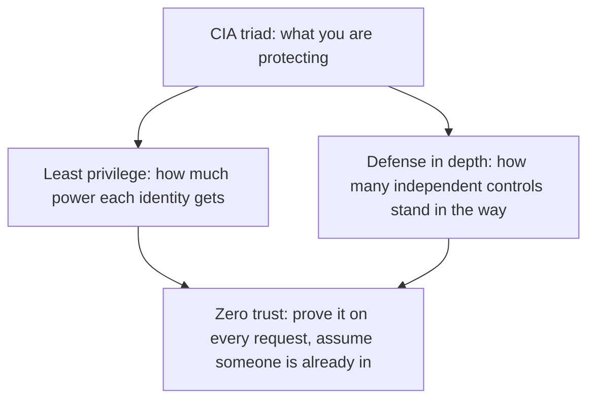

These notes started as a short outline of four ideas that show up in almost every real incident: the CIA triad, least privilege, defense in depth, and zero trust. The outline was thin. This is the filled-in version, with examples, diagrams, and the failure modes that textbooks usually skip.

They are not four separate religions. They stack.

- **[[1. The Security CIA Triad|CIA triad]]** is the scoreboard. Confidentiality, integrity, and availability. Most designs quietly sacrifice one to feed another, and you should be able to say which one and why.
- **[[2. Least Privilege Security|Least privilege]]** shrinks the blast radius. Users, service accounts, CI jobs, and Kubernetes tokens all count. If a stolen credential can do everything, the rest of your controls are already late.
- **[[3. Security Defense-in-Depth|Defense in depth]]** is about independent layers, not five products that fail the same way. One hole should not be enough.
- **[[4. Zero-Trust in Security|Zero trust]]** throws out the old "inside the VPN means trusted" model. Identity, device, and context get checked on the path to the app, not once at the network edge.

> [!tip] How to read these
> Each note has a real incident, a concrete control or command you can actually inspect, a diagram, and a short list of ways the idea falls apart in production. If a section feels obvious, jump to the failure modes. That is usually where the interesting part is.

If you only remember one thing from this folder: controls fail. Design as if the firewall rule is wrong, the token leaked, and the IdP had a bad day. Then see what is still standing.
