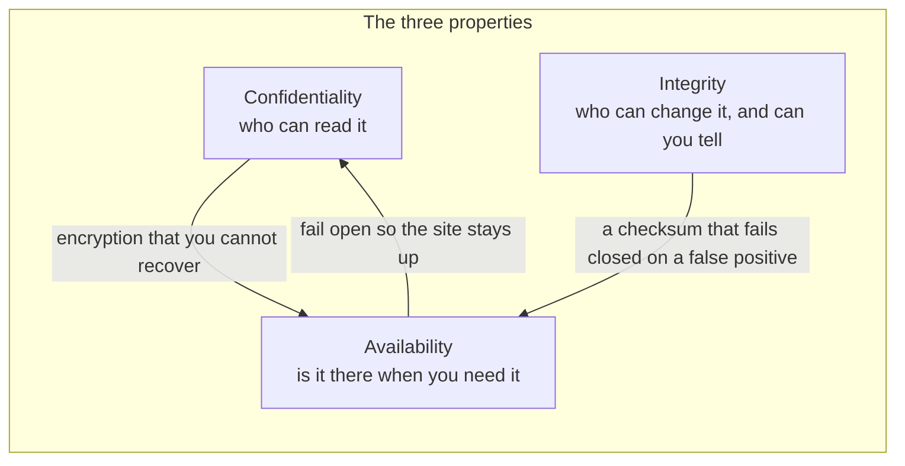
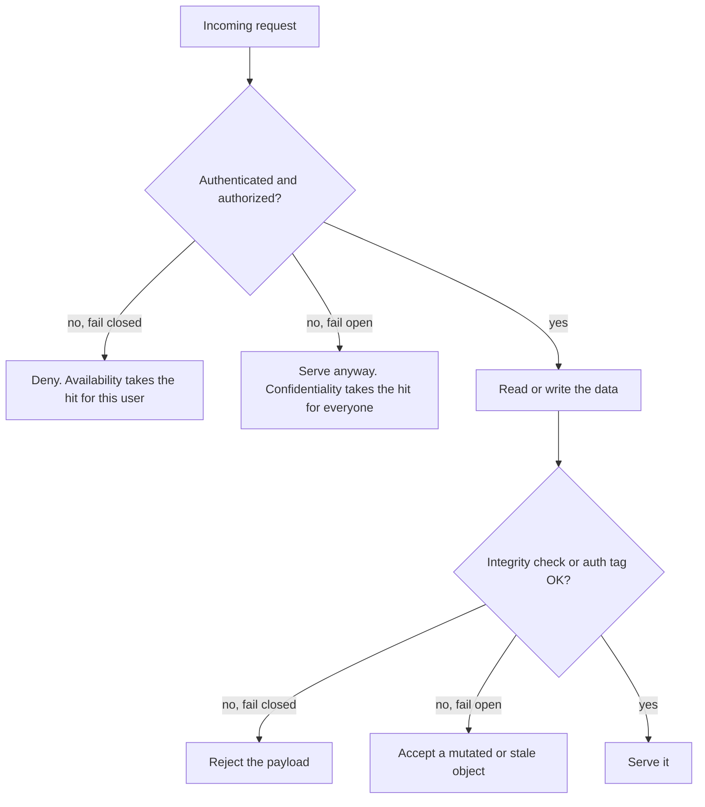

CIA is usually taught as a poster on a wall: confidentiality, integrity, availability. In practice it is three properties that argue with each other, and most incidents are what happens when one of them wins too hard.

A useful way to read any control is to ask which letter it actually buys you, what it costs the other two, and what it looks like when it fails.



## Confidentiality: keeping data away from the wrong eyes

Confidentiality is not "we encrypted it." It is "the people and machines that can read this are the ones we intended, and nobody else." Encryption is one tool. Access control, network isolation, and not logging secrets in the first place are the others.

> [!example] Heartbleed (CVE-2014-0160)
> OpenSSL's TLS heartbeat could be asked to return more memory than the client actually sent. Up to 64KB of process memory came back, over and over: private keys, session cookies, leftover passwords. The data was in transit on a "secure" channel. The library itself leaked the thing the channel was supposed to hide.
>
> That is a confidentiality failure *inside* the crypto stack. A scanner looking for "is TLS on?" would have given the site a gold star.

Other ways this actually breaks:

- **Public object storage.** A single S3 bucket policy or ACL that grants `Principal: "*"` on `s3:GetObject` will happily serve customer exports to the internet. The objects can be encrypted at rest with a KMS key the bucket role can use, so "encryption at rest" is still true and still useless.
- **Logs and debug traces.** I have lost count of how many times an app dumps `Authorization: Bearer ...` or a password reset token into stdout, then ships that log to a system that 200 people can query. The production DB can be tight and the SIEM becomes the leak.
- **Side channels.** Padding oracles, timing on comparison of tokens (`==` instead of a constant-time compare), verbose error messages that distinguish "user not found" from "wrong password."

### Encryption that actually binds confidentiality to integrity

AES-CBC with no MAC is the classic trap. An attacker who can flip bits in ciphertext changes plaintext in a predictable way. You encrypted it, sure. You cannot tell it was edited.

AES-GCM (or ChaCha20-Poly1305) is an AEAD mode: you get an auth tag with the ciphertext. If the tag does not match, you drop the message. TLS 1.3 went all-in on AEAD ciphers for this reason.

```text
  AES-CBC, no MAC          AES-GCM

  attacker flips a bit     attacker flips a bit
          |                        |
          v                        v
  decrypts to garbage      auth tag fails
  or to a useful change    message is rejected
  and the app accepts it
```

At rest, the same rule applies. Disk encryption (BitLocker, LUKS, AWS EBS) protects a stolen drive. It does not protect a stolen IAM role that is allowed to `kms:Decrypt` and `s3:GetObject`. For that you need access control, ideally with per-object or per-tenant keys and a tight grant.

> [!tip] A command worth running
> On a bucket you think is private:
>
> ```bash
> aws s3api get-bucket-policy --bucket example-bucket
> aws s3api get-bucket-acl --bucket example-bucket
> aws s3api get-public-access-block --bucket example-bucket
> ```
>
> If any of those show a public grant, or public access block is off, start there. "We use KMS" is not an answer.

### MFA and session theft

MFA raises the cost of a stolen password. It does not save you if the session cookie, refresh token, or `sudo` ticket is stolen *after* login. That is how a lot of real phishing kits work now: they proxy the real login, including the MFA prompt, and walk away with the session.

Treat confidentiality of *sessions* as its own problem: short lifetimes, binding cookies to a user-agent or device signal where you can, and being able to revoke a session without waiting for it to expire.

## Integrity: knowing when something changed

Integrity means the data, the binary, or the config is what you think it is. If someone altered it, you want that change to be either impossible or loud.

> [!example] SolarWinds SUNBURST (2020)
> Attackers got into the build pipeline and shipped a trojaned `SolarWinds.Orion.Core.BusinessLayer.dll` to thousands of customers, signed with a valid SolarWinds certificate. Downstream shops verified the signature. It was valid. The integrity failure was one step earlier: the build system that produced the file was not a trustworthy source.
>
> File hashes and code signing still matter. They just answer a narrower question than people want them to: "did this come from the vendor's official channel?" not "is the vendor's official channel clean?"

Places integrity dies quietly:

- **Unsigned or loosely pinned updates.** `curl | sudo bash`, a container image tagged `latest`, an npm dependency with no lockfile. The event-stream incident in 2018 is the textbook supply-chain version of this: a popular package gained a new maintainer, then a malicious transitive dependency.
- **Bit flipping on encrypted-but-unsigned data.** Covered above with AES-CBC. Also applies to cookies you encrypt but forget to authenticate, and to URL parameters you "hide" with encoding.
- **Databases with no constraints and no audit.** A price column that accepts negatives, a foreign key you never declared, an admin panel with no write-ahead log of who changed what. Integrity is not only about attackers. Accidental writes count.
- **Git without signing, or signing nobody checks.** A commit SHA records content. It does not record who was allowed to introduce that content unless you require signed commits and reject unsigned ones on the protected branch.

```bash
# What you think you downloaded vs what the vendor published
sha256sum tool.tar.gz
# compare to the vendor's published digest, fetched over a different channel

# Require signed commits on a branch (GitHub branch protection, or a hook)
git log --show-signature -1
```

> [!warning] Hashing is not encryption
> SHA-256 tells you if a byte changed. It does not hide the bytes. HMAC-SHA-256 tells you a holder of the key produced this message. It still does not hide the bytes. If you need both properties, use an AEAD or encrypt-then-MAC on purpose. Do not invent a sandwich out of loose parts at 2am.

## Availability: still being there when it matters

Availability is the letter people ignore until ransomware, a cloud region, or their own fail-closed control takes the service down.

> [!example] Colonial Pipeline (2021)
> The ransomware hit the business network, including billing. The company shut down the pipeline itself as a precaution, because they could not be sure what else was reachable. Fuel availability on the East Coast became a news story. The attacker did not have to brick the OT network to get that outcome. They just had to make the operator distrust their own environment.

Other failure patterns:

- **Single region, single control plane.** Plenty of "highly available" apps have every replica in `us-east-1` and a deploy pipeline that also lives there. When that region has a bad day, the runbooks are in the same fire.
- **Backups you have never restored.** An immutable backup is a checkbox until you try a restore and discover the encryption key is in the same vault that got wiped, or the restore takes 36 hours and your RTO was 2.
- **Self-inflicted fail-closed.** A WAF rule, a certificate rotation, a botched IAM change, or a liveness probe that restarts healthy pods. You can absolutely DoS yourself more reliably than an attacker can.
- **DDoS and resource exhaustion.** This is the obvious one. Rate limits, anycast, and a provider that can absorb junk traffic help. Application-level cheap requests that trigger expensive work (a search endpoint with no cap, a `/report` PDF generator) are often the real weak point.

TLS 1.3 even has a small, honest availability-vs-integrity trade: 0-RTT data is fast, and it can be replayed. If you use 0-RTT for a POST that transfers money, you bought latency with a replay problem. Idempotent GETs are the intended use.

## The three letters fight each other

This is the part I wish I had written down the first time.

| Move | Helps | Hurts | What it looks like |
| --- | --- | --- | --- |
| Encrypt backups with a key only one person has | C | A | Disaster recovery stalls because that person is out, or the key is gone |
| MFA lockout after 5 failures, no break-glass | C | A | A stuck prompt or an IdP outage keeps everyone out, including responders |
| WAF or integrity check that fails closed on any anomaly | I, C | A | A bad signature or a false positive takes the site down |
| Fail open when the auth service is unreachable | A | C | The app stays up, as an unauthenticated app |
| Long-lived sessions so users are not pestered | A (of the login path) | C | A stolen cookie works for days |
| Heavy audit logging of every read | I (accountability) | C, sometimes A | Logs fill with PII, or the volume itself becomes a performance incident |

There is no free choice. Pick the failure mode on purpose.



> [!bug] A pattern I keep seeing
> Teams encrypt in transit, encrypt at rest, then store the same record in a debug snapshot, a support admin tool, and a data-science export with no access review. The triad did not fail in the "security product" layer. It failed in the copies.

## A request walking through all three

Take a password change on a web app. Here is a boring, correct shape:

1. **Confidentiality.** TLS to the edge and to the app. The current password and the new password never hit a log or a crash dump. The stored verifier is a slow hash (Argon2id or bcrypt) with a unique salt, not reversible encryption.
2. **Integrity.** The change is bound to a live, authenticated session or a single-use reset token. The token is hashed in the database so a stolen backup of the token table is not a pile of valid resets. CSRF is blocked. The response does not let an attacker flip a user id in the form and reset someone else.
3. **Availability.** The reset email and the change endpoint are rate limited. One user cannot lock every account in the system by spraying resets. If the mail provider is down, the existing password still works.

If you skip one letter, the feature still "works" in a demo and fails in a very specific way in the wild.

## Quick checks

- For any store of data: who can read it, who can write it, and what happens if that store is gone for a day?
- For any crypto: is there an auth tag or a signature, and who holds the key?
- For any control that denies traffic: do you fail open or closed, and did anyone agree to that?
- For any backup: when was the last restore, and can the people on-call do it without the one person who "knows the tape library"?

The triad is not a personality test for your program. It is a way to stop pretending a single product covered all three letters.
