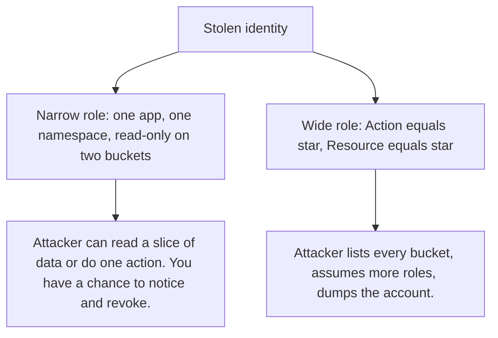

Least privilege is simple to say and easy to get wrong: every identity should be able to do the work in front of it, and nothing else. The identity can be a person, a CI job, a Lambda role, a Kubernetes service account, a database user, or a laptop cert. Attackers do not care which one you forgot about.

The point is not stinginess. The point is blast radius. A stolen credential should feel like a small fire, not the keys to the building.



## The incident that still teaches this

> [!example] Capital One, 2019
> A misconfigured WAF sat on an EC2 instance. The attacker used server-side request forgery to reach the instance metadata service at `169.254.169.254` and pulled the instance role's temporary credentials. That role could list and read a *lot* of S3 buckets. More than 100 million people's data came out.
>
> The SSRF was the door. The overly broad IAM role was the hallway. If the role had been limited to the buckets that WAF actually needed, the same bug would have been a bad day for WAF logs, not a historic breach.

The metadata hop looks like this when IMDSv1 is still allowed:

```bash
# From a workload that can be tricked into fetching a URL
curl http://169.254.169.254/latest/meta-data/iam/security-credentials/
curl http://169.254.169.254/latest/meta-data/iam/security-credentials/ROLE-NAME
```

IMDSv2 makes that harder by requiring a PUT for a session token first, with a hop limit you can set to 1 so the token does not transit a proxied request. You should still assume someone will get a role someday, and make that role boring.

```bash
# What can this role actually do?
aws iam simulate-principal-policy \
  --policy-source-arn arn:aws:iam::123456789012:role/WafRole \
  --action-names s3:GetObject s3:ListBucket s3:PutObject iam:PassRole sts:AssumeRole \
  --resource-arns arn:aws:s3:::should-not-be-readable/*
```

If the answer is "allow" on things the service has no business touching, that is the bug, even if no one has exploited it yet.

## Humans, services, and the stuff in between

### People

Role-based access is the default starting point: put users in groups that match a job, not a person. A finance analyst gets the finance group. They do not get a one-off policy because a ticket was late on a Friday.

That still leaves a few traps:

- **Privilege creep.** Someone changes teams and keeps the old groups "just in case." Three years later they are in eight groups and effectively an admin.
- **Standing admin.** Domain Admin, `AdministratorAccess`, or a Kubernetes `cluster-admin` binding that is used for daily work. Daily work should happen as a normal user. Admin should be a separate account or a just-in-time elevation that expires.
- **Separation of duties.** The person who can propose a payment should not be the only person who can approve it. The person who can merge to `main` should not be the only person who can change branch protection.

Just-in-time access ( PAM tools, temporary group membership, AWS IAM Identity Center permission sets with a duration) is how you stop "I'll leave myself in the admin group because I might need it next week."

### Services and machines

This is where I see the biggest gaps, because nobody is logging in as those identities every day.

- **Database users.** The app role should not be `sa` or `root`. It should not be able to `DROP TABLE` or `GRANT`. If you need migrations, give those to a different role that runs in the migrate job, not in the request path.
- **CI/CD.** A GitHub Actions workflow that needs to comment on a PR does not need `contents: write` on the whole repo, and it definitely does not need the AWS role that can also prod-deploy. Split the workflows. Scope the OIDC role to one set of actions and one set of resources.
- **Cloud instance roles.** Prefer a role per service, not a shared "app-prod" role that 14 teams dump policies onto.
- **Containers.** `privileged: true` and `CAP_SYS_ADMIN` are almost root on the node. Drop capabilities you do not need. Do not mount the Docker socket into a pod unless you are ready to admit that pod can be the host.

```yaml
# Kubernetes: stop handing every pod a token that talks to the API
apiVersion: v1
kind: ServiceAccount
metadata:
  name: web
  namespace: prod
automountServiceAccountToken: false
```

If a pod *does* need the API, give it a dedicated service account with a tight Role, not the default account in the namespace.

```bash
kubectl auth can-i --list --as system:serviceaccount:prod:web -n prod
```

If that list includes `secrets` in other namespaces, or `escalate`, or `bind`, fix it before you need the story of how a single RCE became a cluster takeover.

### Linux and Windows, quickly

Root and Administrator are not the only privileged identities.

```bash
# Linux: what can this binary do without being root?
getcap /usr/bin/ping
# CAP_NET_RAW is expected for ping. CAP_SYS_ADMIN on a random tool is not.

sudo -l        # what can *this* user run as root?
id             # groups can be back doors (docker, lxd, disk, wheel)
```

On Windows, `SeImpersonatePrivilege` on a service account is how a long line of "Potato" local privilege escalations work. The account did not look like an admin. The privilege was enough.

> [!tip] Docker group is root
> Membership in `docker` (or write access to the Docker socket) is a root equivalent on that machine. Same for `lxd`. Treat those groups like sudo, not like a convenience flag for developers.

## Confused deputies

Sometimes the identity that is too wide is not the attacker's. It is a helper you built.

A classic cloud version: a role trusts `sts:AssumeRole` from many accounts, or a function takes an ARN and then uses *its own* powerful role to read it. The attacker never steals your role. They talk a trusted service into using its privileges for them. That is the confused deputy.

Fixes look unglamorous: `aws:SourceAccount` and `aws:SourceArn` conditions, passing a session policy that shrinks the temporary creds, and not taking a resource ARN from the caller without checking it.

## What a tight setup looks like

```text
                    +------------------+
  human  ---------> |  SSO / IdP       |  MFA, short session
                    +--------+---------+
                             |
                    +--------v---------+
                    | job-shaped role  |  no standing admin
                    +--------+---------+
                             |
          +------------------+------------------+
          |                                     |
          v                                     v
   break-glass role                      app / service role
   (offline, monitored,                 (one workload,
    time-limited,                       named resources,
    two people)                         no iam:*)
```

Break-glass is allowed. It should be painful on purpose: a sealed process, a ticket, a loud alert when the role is used, and a forced expiry. If break-glass is "the shared password in the team wiki," you do not have break-glass. You have a second production admin that nobody rotates.

## Failure modes

> [!bug] Ways least privilege quietly dies
> - A ticket says "just give them admin so we can ship," and the grant is still there a year later.
> - Wildcards. `s3:*` on `arn:aws:s3:::*` is not a starting point, it is the end of the conversation.
> - Default allow in Kubernetes NetworkPolicies or in a security group "because the app broke."
> - One shared service account for an entire namespace.
> - Access reviews that only look at humans, never at bots and cloud roles.
> - Logging that records *that* an API call happened, but not *as whom*, so you cannot revoke the right identity.

A decent review cadence is: when someone changes teams or leaves, when a service is decommissioned, and on a calendar even if nothing changed. The calendar catch is for the role that slowly collected "temporary" statements.

## Quick checks

```bash
# AWS: find policies with Action and Resource wildcards (then actually read them)
aws iam list-policies --scope Local --query 'Policies[].Arn' --output text

# Kubernetes: who is cluster-admin?
kubectl get clusterrolebinding -o json | \
  jq -r '.items[] | select(.roleRef.name=="cluster-admin") | .metadata.name, .subjects'

# Linux: setuid and unexpected capabilities
find / -perm -4000 -type f 2>/dev/null
getcap -r / 2>/dev/null
```

If a compromised intern laptop, a leaked CI token, or a single SSRF can become "we have to rotate the whole account," the privilege model is the incident waiting to happen. Shrink it now, while the identity is still yours.
