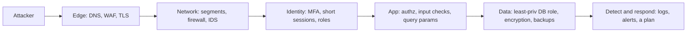
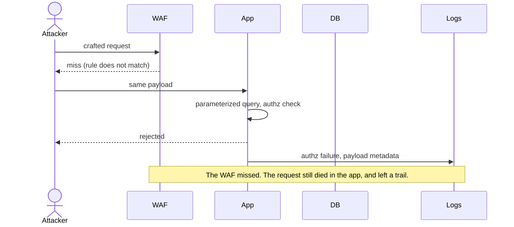

Defense in depth is not "buy more boxes." It is arranging controls so that one failure is not enough. The layers have to fail *differently*. Three antivirus products with the same signature set are not three layers. They are one layer with a higher invoice.

I picture it like Swiss cheese (James Reason's model): every layer has holes. You are trying to keep the holes from lining up long enough for someone to walk through the stack.



If L4 is "the WAF will catch SQL injection" and the application itself concatenates SQL anyway, you do not have two layers. You have one hope.

## What a request should actually go through

A typical web app, drawn as a packet's day job:

```text
  client
    |
    |  DNS, maybe a bot/DDoS filter
    v
  +------------------+
  | CDN / WAF        |  known-bad paths, rate limits, TLS
  +--------+---------+
           |
           v
  +------------------+
  | load balancer    |  only talks to the app subnet
  +--------+---------+
           |
           v
  +------------------+
  | app              |  session, authz, parameterized queries
  |                  |  no direct SSH from the internet
  +--------+---------+
           |
           |  TLS, app-specific DB user
           v
  +------------------+
  | database         |  no public IP, no app-server admin role
  +------------------+

  off to the side, not in the request path:
  backups (immutable, tested restores)
  logs (tamper-evident, not writable by the app role that might get owned)
```

Each box should have an answer to "what does this stop?" and "what happens when this is wrong or down?" If two boxes give the same answer, one of them is decoration.

| Layer | Stops | Fails when |
| --- | --- | --- |
| WAF / edge | Obvious exploit strings, volume floods, some bots | Bypass with encoding, a route the WAF does not see, or a rule you set to detect-only |
| Network segment | An attacker in the app subnet casually talking to payroll or OT | Flat networks, "any/any" temporary rules that became permanent, a jump host that can reach everything |
| Identity | Stolen passwords, random internet logins | Session theft after MFA, standing admin, MFA fatigue |
| Application | The actual business logic abuse | The team treated the WAF as the input validator |
| Data layer | A wide-open app turning into a wide-open database | The app connects as a superuser, or backups are reachable with the same creds |
| Detection | Quiet dwell time | Logs go to a place the attacker can wipe, alerts that nobody owns, a cert on the scanner that expired |

## Incidents where the holes lined up

> [!example] Target, 2013
> An HVAC vendor's credentials were stolen and used to get onto Target's network. From there the attackers reached systems that could talk to point-of-sale, and installed memory-scraping malware. About 40 million card numbers walked out.
>
> Vendor access was one hole. A network that let that access get close to cardholder data was the second. Detection that did not stop it in time was the third. Any one of those, done properly, would have changed the ending.

> [!example] Equifax, 2017
> An unpatched Apache Struts bug (CVE-2017-5638) was the entry. A scanner that should have helped was effectively blind because of an expired certificate. A large pile of personal data sat where a single foothold could reach it. This is the same pattern: exploit, missed detection, weak segmentation. The patch existed. The layer that was supposed to notice the miss was also down.

> [!example] NotPetya, 2017
> The initial implant rode a compromised software update for a Ukrainian tax package (M.E.Doc). After that it spread with stolen credentials and EternalBlue, fast enough that "we will just restore" stopped being a plan for a lot of companies, including ones that had never heard of M.E.Doc.
>
> A signed update channel is a layer. So is patching SMB. So is dropping admin credentials out of memory and segmenting so a finance workstation cannot reach every server. NotPetya is what it looks like when lateral movement does not meet any independent friction.

## Independent failures, not duplicate products

A test I like: name the bug that takes out layer A, then ask whether layer B still works.

- A WAF bypass (chunked encoding, a new path, a JSON body the rule does not parse) should still hit parameterized queries in the app.
- A stolen VPN or laptop should still hit per-app authorization and a database role that cannot dump every table.
- A missed OS patch should still meet a network policy that the service cannot be reached from the guest Wi-Fi.
- A logging outage should not also be a backup outage. Put those on different systems.



> [!warning] Fail open vs fail closed is a layer decision
> If the WAF or IdP is down, does traffic pass or drop? Fail open protects availability and can erase the layer for everyone. Fail closed protects the other letters and can take you off the air. Pick it per layer, write it down, and test the down case. A firewall that "fails safe" by becoming any/any during a policy-compile error is not a layer. It is a timed hidden door.

## Physical, people, and process still count

Badge readers, a locked rack, and "you cannot walk a USB into the lab" are layers. So is a hire-and-offboard process that actually disables accounts the same day. So is a restore test, a tabletop, and a person who owns the on-call alert at 3am.

User training is a thin layer on its own. It gets useful when it is stacked with: email authentication (SPF, DKIM, DMARC), attachment sandboxing, blocking macros from the internet, and a way to report a message that does not require a treasure hunt.

## How this goes wrong

> [!bug] Decoration and single points
> - "We have a WAF" as the entire application security program.
> - Six tools, one dashboard nobody watches, three of the agents disabled because they fought each other.
> - Detection that writes to a host the attacker already owns, so the first thing they delete is their trail.
> - A single jump box that can reach every segment, with a shared key.
> - Change windows that skip the scanner "just this once," repeatedly.
> - Layers only at the perimeter, with a flat trusted inside. That is a moat and a party inside the castle.

Defense in depth is working when an incident report says "they got through X, and then Y stopped them." It is not working when the report says "the firewall was the only thing, and it was in detect mode."

## Quick checks

- For one critical transaction (password change, payment, admin grant), list every control on the path. Mark which ones are independent.
- Pick a recent CVE in your stack and walk it: which layer should have caught a working exploit, and would the next one still hold?
- Restore a backup on a calendar, not as a thought experiment.
- Confirm logs from the app and the edge land somewhere the app role cannot truncate.
- Look for temporary firewall rules older than 30 days.

If you want a single sentence for this one: put something still standing behind every control you already trust.
