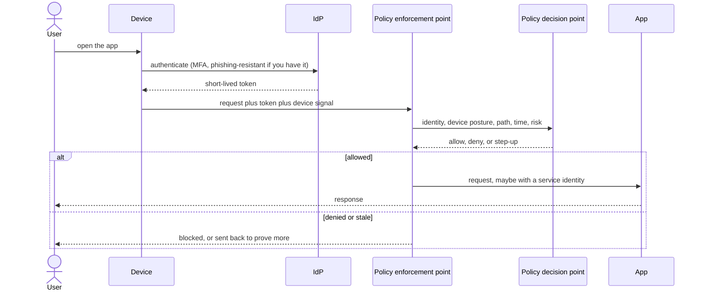

The old default was a hard edge and a soft inside. Get a VPN or a badge on the office network, and a lot of systems treated you as a friend. That made sense when "work" was a building. It does not make sense when the app is in someone else's data center, the user is in a cafe, and the laptop might already be someone else's too.

Zero trust is the bet that the network location is not a good reason to trust a request. You check the user, the device, and the context against a policy, for that request, on the way to that app. Then you check again later, because a session that was fine at 9am may not be fine at noon.

Google's public version of this grew out of Operation Aurora in 2009, when a serious intrusion made "the intranet is safe" a hard story to keep telling. BeyondCorp was the result: no privileged corporate network, access based on who you are and the state of your device, from wherever you are.



The two boxes in the middle matter. The **policy decision point** answers "should this be allowed?" The **policy enforcement point** is the thing that can actually stop the call: an identity-aware proxy, a service mesh sidecar, a library, a gateway. A policy that nobody enforces is a wiki page.

## What this is not

A VPN with a new product name is not zero trust. If the flow is "connect to the tunnel, then roam the 10.0.0.0/8 at will," you have moved the old perimeter to a nicer client. Same for "we turned on SSO" and then left every internal tool reachable by IP once you are on the office Wi-Fi.

Zero trust is also not "make users click MFA until they cry." If you prompt on every pixel, people approve prompts they did not start. Phishing-resistant factors (security keys, platform passkeys) plus *conditional* step-up on unusual or sensitive actions beats prompt spam.

> [!warning] The IdP is now in the request path
> If every app fails closed when the identity provider is unreachable, an IdP outage is a company-wide outage. That is an availability choice (see [[1. The Security CIA Triad]]). Plan for it: status for the IdP, cached short-lived sessions with a hard cap, a tightly controlled break-glass path, and knowing which apps must stay up if SSO is on fire.

## The pieces that actually move the needle

### Identity on every request

Authenticate the user or the workload, not the subnet. For people: SSO, short sessions, phishing-resistant MFA, and a way to revoke a session today. For services: a workload identity (cloud IAM roles, SPIFFE IDs, bound Kubernetes service accounts), not a long-lived shared password in a config map.

Tokens should be boring and brief. A 12-hour bearer token in a frontend is a gift. Bind what you can (audience, nonce, sender constraints) and rotate without a ceremony.

### Device posture

A valid password on a jailbroken, unencrypted, month-behind laptop is not the same request as one from a managed device with disk encryption and a current patch level. Device posture is how you say that in policy.

You do not need a perfect inventory on day one. Start with signals you already have: MDM compliance, disk encryption, and whether the browser or client is current. Deny or restrict the high-value apps when those signals are missing.

### Least privilege, applied per request

Zero trust without [[2. Least Privilege Security|least privilege]] is just a fancy front door to the same wide-open interior. The policy should name the app and the action, not "full network after login."

This is also why microsegmentation shows up in the same conversations. A workload that serves the storefront does not need a route to the payroll database, even if both are "in prod." In Kubernetes that can be a NetworkPolicy. In a mesh, it can be mTLS plus an authorization policy that names the client identity, not the pod IP (IPs change, identities can stay stable).

```yaml
# Sketch: allow only the checkout service identity to call payments
apiVersion: security.istio.io/v1
kind: AuthorizationPolicy
metadata:
  name: payments-inbound
  namespace: payments
spec:
  action: ALLOW
  rules:
    - from:
        - source:
            principals: ["cluster.local/ns/shop/sa/checkout"]
      to:
        - operation:
            methods: ["POST"]
            paths: ["/charge"]
```

### Assume someone is already in

Design the inside as if a laptop is stolen and a token has been copied. Then ask: can that identity wander? Can it dump data the user never opens in the UI? Can it disable logging? Lateral movement is the test. If a single phished inbox becomes a domain admin in an afternoon, the policy engine is not the real problem. The standing privilege is.

## A concrete contrast: VPN vs ZTNA

```text
  Classic VPN                         Per-app ZTNA / IAP

  laptop                              laptop
    |                                   |
    |  one tunnel                       |  HTTPS to a proxy
    v                                   v
  +------------------+                +------------------+
  |  "inside"        |                |  PEP: check user,|
  |  wide routing    |                |  device, policy  |
  |  then hope ACLs  |                +--------+---------+
  +--------+---------+                         |
           |                                   v
           v                          +------------------+
  lots of ports and                   |  only that app   |
  internal apps                       +------------------+
```

In the left picture, a single compromised machine is on the network with you. In the right picture, the machine can try to call one app, and the proxy can say no without ever giving it a route to anything else.

## Failure modes and theater

> [!bug] Ways this gets faked or stalled
> - Rebranded VPN, same flat network after connect.
> - Policy that is a single "is this user in the employees group?" check, then full access.
> - Device posture collected and never used in a deny rule.
> - Long-lived API keys that skip the proxy because "the integration broke."
> - A mesh installed for mTLS, with `AuthorizationPolicy` left at allow-all.
> - Exception lists that grow faster than the policy, especially for contractors and "temporary" service accounts.
> - No continuous piece: login at 9am, no re-check when the device falls out of compliance at 11.

Rollout works better as a few high-value apps first (email, admin panels, source control, the production console) than as a three-year program that promises every printer on day one. Put the enforcement point in front, watch the denied requests, tighten. Leave a logged break-glass, not a silent bypass.

## Quick checks

- Can a user on the VPN or office Wi-Fi reach an internal app with no identity in the request? If yes, the network is still doing the trusting.
- How long can a stolen session live, and can you revoke it without rotating a global secret?
- For a service-to-service call, is the allow rule based on an identity or on an IP?
- If the IdP is down for an hour, what stays up, and is that a documented choice?
- Pick one sensitive action (export of customer data, production SSH, a payment). Does it require a fresh proof, or just yesterday's cookie?

Zero trust is working when a request from "inside" is treated with the same suspicion as one from a hotel network, and when a stolen session dies before it becomes a tour of the company. Everything else is branding.
